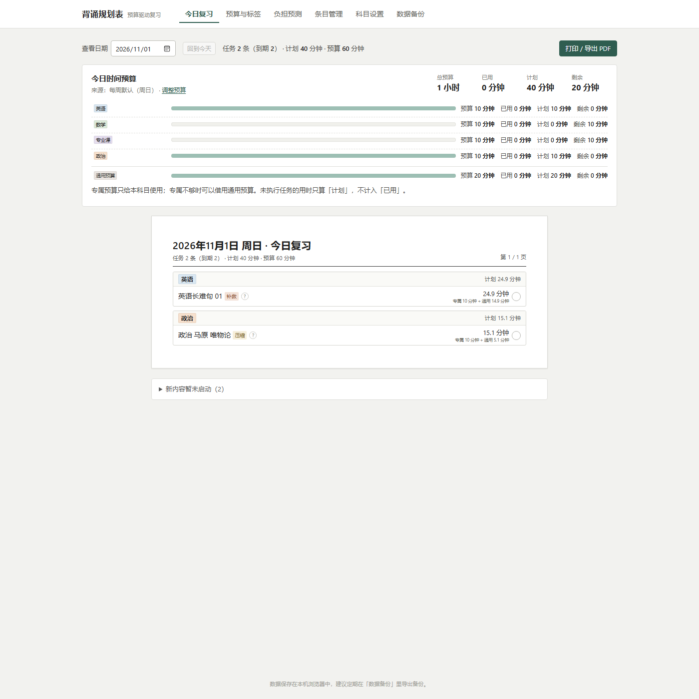
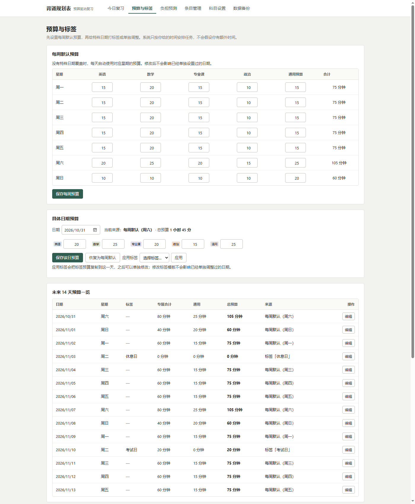
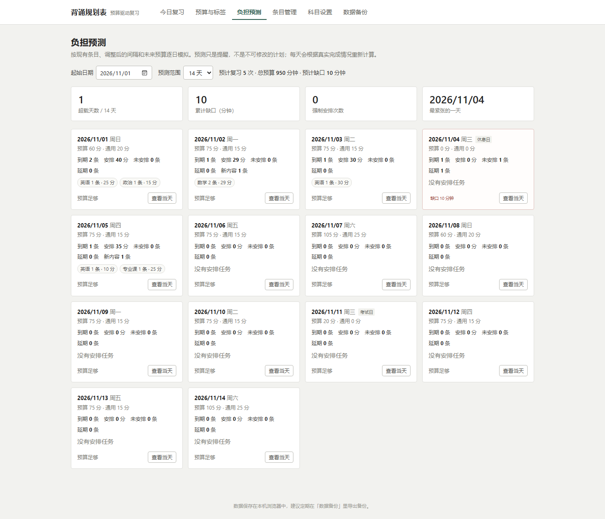
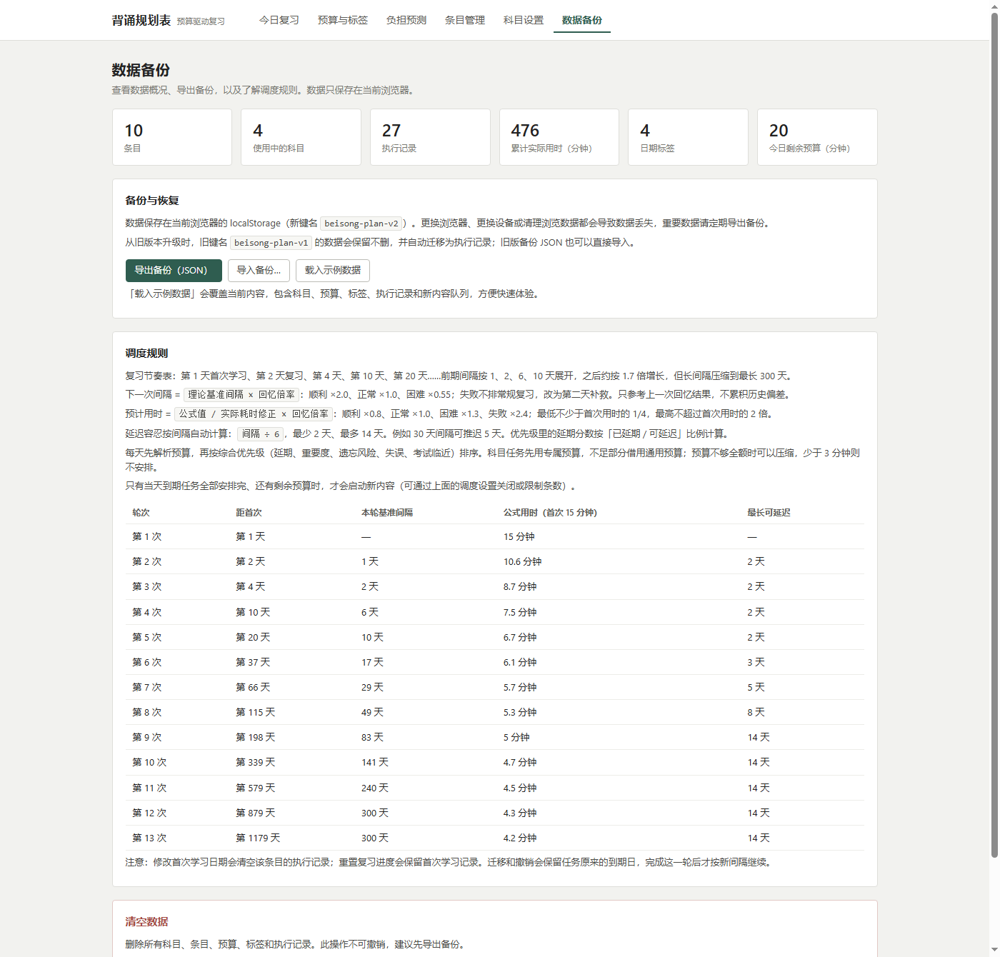

# 背诵规划表

一个**以每天可投入的时间预算为约束**的背诵复习工具。录入条目和首次背诵信息后，系统根据科目专属预算、通用预算和每天的实际可用时间，动态决定今天该学什么、复习什么、哪些任务要延期，并用每次执行的真实耗时与回忆结果持续修正计划。

纯前端、无第三方依赖、无构建步骤，数据保存在浏览器本地；`file://` 直接双击 `index.html` 也能使用。

**在线使用：<https://gwierotoku.github.io/beisong-planner-v2/>**

## 快速开始

1. 双击 `index.html`，用最新版 Edge / Chrome 打开。
2. 到「科目设置」添加科目（会自动获得每天 15 分钟的初始预算）。
3. 到「预算与标签」调整每周默认预算：每个科目一份专属预算，另有一份所有科目共享的通用预算。
4. 到「条目管理」添加要背的内容：可以指定首次学习日期，也可以交给系统按预算安排。
5. 每天打开「今日复习」：系统只安排今天预算内的任务，按科目分组列出；完成后点圆圈，记录**实际用时**和**回忆结果**。
6. 想快速体验：进入「数据备份」→「载入示例数据」。

> 换浏览器、换设备或清理浏览器数据都会丢失数据，请定期在「数据备份」里导出 JSON。

## 界面预览

今日复习：预算使用情况、今日任务、专属/通用分配与可解释的调度。



预算与标签：每周默认预算、具体日期预算、未来 14 天预算一览。



负担预测：未来每天的预算、各科目任务、缺口与延期提示。



复习节奏表：轮次、距首次天数、基准间隔、公式用时和最长可延迟天数。



## 核心理念

- 时间预算由用户决定，系统不假设用户有额外时间。
- 科目专属预算 + 全局通用预算，通用预算先到先得、不会重复占用。
- 到期任务不一定当天完成：间隔越长允许推迟越久（1 个月约 5 天，最少 2 天、最多 14 天），超过后优先强制安排，但最多只超出当天可用预算的 25%；休息日/考试日可关闭强制。
- 复习间隔与预计用时都从「固定公式」变成「先验 + 实际表现修正」。
- 新内容与旧复习共享同一份科目预算；某一科到期任务没排下时，只冻结这一科的新内容，其他科目仍可启动。
- 历史执行记录不可变；所有计划都可以由当前数据重新计算并解释。

## 功能

### 今日复习

- 顶部显示当日预算使用情况：各科目专属预算 / 已用 / 计划 / 剩余，通用预算，总预算与实际用时。
- 任务按科目分组，单列竖向排列，标注「逾期 / 延期 / 补救 / 新内容 / 压缩 / 强制 / 提前」。
- 每条任务显示今日分配（专属 + 通用），行内「?」可以查看为什么安排在今天、优先级得分明细和当天预算。
- 完成后记录实际用时、回忆结果（顺利 / 正常 / 困难 / 失败）、本次难度和备注；失败会安排第二天的补救学习，补救完成后第二天重做失败的那一轮，成功后才继续往后走。
- 预算不够时显示「未安排任务」及原因、缺口分钟数；不会假装所有任务都能完成。
- 压缩安排默认只记时间、不推进轮次；弹窗里可以明确选择「已完整复习本轮」才按回忆结果推进。
- 「已完成」区可撤销记录。撤销会**恢复这次任务原来的到期日**（而不是按新间隔推算到下一轮）；若今天预算不足会明确提示并放入「未安排任务」。
- 可切换查看历史或未来日期；未来日期不能提前标记完成。
- 打印 / 导出 PDF：只打印任务清单，A4 纵向，按科目分组自动分页。

### 预算与标签

- **每周默认预算**：周一至周日分别设置各科目预算和通用预算。
- **具体日期预算**：优先级最高，可以单独覆盖某一天；一键恢复为每周默认。
- **日期标签**：保存一套预算模板（普通日 / 考试日 / 考试前一天 / 活动日 / 空闲日 / 休息日 / 其他），应用到日期时会**复制**一份预算，之后可单独修改；休息日/考试日默认关闭强制安排，可在标签里单独打开。
- 修改标签模板支持选择是否同步到「已应用该标签且没有手动改过」的日期；手动调整过的日期永不被覆盖。
- 删除标签不会删除已经应用到日期的预算。
- 未来 14 天预算一览：日期、星期、标签、专属合计、通用预算、总预算、来源。
- 调度设置：是否自动安排新内容、每日新内容上限、是否允许提前复习、最多提前几天、预测默认天数。

### 负担预测

- 按 7 / 14 / 21 天逐日模拟：到期任务、各科目安排条数与分钟数、每日总预算与通用预算、未安排条数、缺口、延期任务数、强制安排。
- 已安排的任务会按「正常回忆」继续向后推演后续复习（包括新内容），不再只看眼前一轮。
- 超载的日子会高亮，并给出累计缺口、超载天数、最紧张的一天。
- 预算变化、标签应用、完成记录变化后，预测会立即重算。

### 条目管理

- 按名称 / 科目搜索，按科目筛选，按名称、重要程度、首次日期、下次复习、添加时间排序。
- 显示当前进度、下次复习（含逾期）、预计用时、状态（使用中 / 暂停 / 归档）。
- 添加 / 编辑条目：重要程度、初始难度、首次学习用时、固定首次日期或「由系统按预算安排」。
- 详情页：调整后的间隔 vs 理论间隔、预计用时及参考样本数、累计实际用时、回忆失败次数、全部执行记录、理论计划预览、补记完成、撤销、重置进度。
- 修改首次学习日期会清空该条目的学习记录并重新开始（会二次确认）；重置进度会保留首次学习记录。

### 科目设置

- 新增、改名、改色、停用、恢复、删除科目；删除前必须没有条目。
- 显示每个科目的条目数、每周专属预算合计。
- 新科目自动加入每周模板（默认 15 分钟/天），停用科目仍保留预算和已有条目。

### 数据备份

- 导出 v2 JSON、导入 v1/v2 JSON、载入示例数据、清空全部数据。
- 显示条目、科目、执行记录、累计实际用时、标签数、今日剩余预算。
- 内置完整调度规则说明和旧版本迁移提示。

## 调度规则

### 1. 理论复习节奏（表格化）

默认节奏为：**第 1 天首次 → 第 2 天 → 第 4 天 → 第 10 天 → 第 20 天 → 第 37 天 → 第 66 天 → 第 115 天 → 第 198 天 → 第 339 天 → 第 579 天 → 第 879 天 → 第 1179 天**。

- 共 13 轮，最后一轮约 3.2 年后。
- 前期间隔为 1、2、6、10 天，之后约按 1.7 倍增长。
- 长间隔压缩到最长 **300 天**（旧版最后的 400+ 天空档不再出现）。
- 公式用时 = `首次用时 / √n`，只作为初始参考。

### 2. 动态间隔

- 下一次间隔 = `理论基准间隔 × 回忆倍率`。
- 回忆倍率：顺利 ×2.0、正常 ×1.0、困难 ×0.55；失败不排常规复习，改为第二天补救。
- **只参考上一次回忆结果**，不再累积历史偏差；最长 300 天、最短 1 天。
- 失败**不推进轮次**：补救完成后第二天重做失败的那一轮，成功后才进入下一轮；同一轮连续失败 3 次会回退一轮，用更短的间隔重新巩固。
- 延期只影响安排日期，不改变记忆间隔。

### 3. 延迟容忍

- 延迟容忍天数 = `间隔 ÷ 6`，最少 2 天、最多 14 天。
- 例如：7 天间隔可推迟 2 天，30 天间隔可推迟 5 天，100 天以上按 14 天上限。
- 优先级里的延期紧迫按「已延期天数 / 可延迟天数」计算；达到上限才优先强制安排，并提示预算不足。
- 强制安排最多使用当天可用预算的 1.25 倍；超出部分进入未安排队列，不会无限击穿。休息日/考试日默认关闭强制，可在标签或当天预算里打开。

### 4. 动态预计用时

- 以公式值为先验；取最近 8 条执行记录的「实际 / 计划」比值做平滑（新数据权重 0.4），单条比值限制在 0.25–4。
- 再乘上一次回忆倍率：顺利 ×0.8、正常 ×1.0、困难 ×1.3、失败 ×2.4。
- 下限为首次用时的 **1/4**，上限为首次用时的 **2 倍**（并受 0.5–240 分钟限制）。
- 因预算不足被压缩安排的任务，默认只记时间、不推进轮次，也不参与耗时修正；如果用户明确选择「已完整复习本轮」，才按正常记录推进。

### 5. 每日调度

1. 解析当日预算，扣除当天已完成任务的实际用量，得到剩余专属预算和通用预算。
2. 收集每个启用条目的下一个任务（首次学习 / 复习 / 补救）和新内容队列。
3. 到期任务按综合优先级排序：延期紧迫（按可延迟天数比例，最高 40）+ 重要度（0–20）+ 遗忘风险（0–12）+ 失误累积（0–12）+ 补救任务 15 + 首次学习任务 8 + 考试临近（0/6/12/18）。
4. 超过各自可延迟天数的任务先强制安排；强制部分最多使用当天可用预算的 1.25 倍，休息日/考试日可关闭强制。
5. 其余到期任务逐个从「专属 → 通用」扣减；预算不够全额时允许压缩，但压缩后的单次时长不少于 3 分钟；任务本身预计不足 3 分钟时按全额安排。
6. 所有到期任务安排完后，如果还有剩余预算，先安排「困难/失败过、间隔至少 2 天」的提前复习（可在设置里关闭或调整提前天数）。
7. 最后按新内容优先级启动新内容；只冻结「本科目还有到期任务未安排」的科目，其他科目仍可使用自己的预算（每日条数上限，默认 3 条）。
8. 记录每个未安排任务的原因和缺口；输出超支、强制上限、休息日关闭强制、预算不足等警告。

任务身份由「条目 + 轮次 + 类型」唯一确定，调度是纯函数：同一份数据、同一天、同一预算，结果确定，重复打开不会重复创建任务。

### 6. 未来预测

从今天开始逐日模拟，把当天没安排下的任务传递给下一天；已安排的任务视为当天完成，并按「正常回忆」继续生成后续复习（包括新内容）。预测会考虑每周预算、日期标签、手动覆盖、当前间隔、延迟容忍和强制上限。

## 旧版本数据迁移

- 新数据写入 `beisong-plan-v2`；旧键名 `beisong-plan-v1` **原样保留不删**。
- 旧 `entries[].done` 会转成执行记录：
  - `done["1"]` → 首次学习记录；
  - `done[n]`（n≥2）→ 第 n 次复习记录，计划/实际用时取当时的公式值，回忆结果记为「正常」；
  - 记录 ID 固定（`legacy-learn-<条目ID>`、`legacy-review-<条目ID>-<n>`），重复加载/导入不会产生重复记录。
- 旧字段 `done` 保存在 `entry.legacyDone` 中，导出备份仍然包含。
- 旧数据没有预算，迁移时临时给每个科目每天 20 分钟 + 通用 20 分钟，并在今日页提示到预算页调整。
- 旧版预备诵（首次日期在未来）保持「首次学习未完成」；旧版首次日期在过去且没有完成记录的条目，会自动补一条首次学习记录（与旧行为一致）。
- 旧版「自动跳过已过去轮次」不再伪造复习记录：只保留首次学习，下一次复习立即进入待办。
- 迁移时保留旧版「下一轮原始计划日期」：按旧版 1.7 倍节奏计算，不会被新版表格或动态间隔改写；完成这一轮之后，后续轮次才按新规则重算。
- 迁移后的记录仍会照常调用预算：旧计划日期在过去的任务会显示为逾期/延期，由当日预算决定能否安排。
- 如果之前已经用旧重构版本导入过 v1 数据，升级后首次打开会自动补一次旧计划日期（`meta.pendingPinned`），并在今日页提示：可以「保留旧计划」或「改用新规则重排」；选择之后不再重复提示。新添加的条目不受影响，仍按新规则调度。

## 文件结构

```text
index.html                 页面骨架与脚本加载顺序
styles.css                 平面风样式、响应式布局、A4 打印分页
app.js                     界面渲染、表单、事件、打印
js/core.js                 日期、数值、格式化、颜色、转义
js/review.js               理论轮次、动态间隔、条目状态推导
js/duration.js             预计耗时估计
js/priority.js             任务优先级、考试临近度
js/budget.js               每周模板、标签、日期覆盖、预算解析与实际用量
js/scheduler.js            候选任务收集、单日预算调度
js/forecast.js             多日模拟预测
js/model.js                数据结构、校验、v1→v2 迁移、存储、示例数据
tests/run-tests.js         Node 单元测试（82 项）
tests/browser-smoke.html   浏览器冒烟测试（自动载入示例数据并切换全部视图）
tests/legacy-seed.html     写入 v1 数据后跳转，验证浏览器端迁移
tests/preview.html         生成示例数据后跳转到真实页面，便于截图
tests/stress.html          60 条任务的打印分页压力测试
docs/重构方案.md           现有架构分析、数据模型与算法设计
docs/images/               README 使用的界面截图
```

`index.html` 直接双击即可，无需构建。业务逻辑全部在 `js/` 中，`app.js` 只负责界面。

## 数据格式

localStorage 键名：`beisong-plan-v2`

```json
{
  "version": 2,
  "meta": { "createdAt": "...", "migratedFrom": 1, "migratedAt": "...", "pendingPinned": true, "pinnedCount": 3, "pinPending": false, "pinAcknowledged": true, "notice": "" },
  "subjects": [
    { "id": "s1", "name": "数学", "color": "#ddeada", "archived": false, "createdAt": "..." }
  ],
  "entries": [
    {
      "id": "e1",
      "name": "极限的定义",
      "subjectId": "s1",
      "importance": 4,
      "difficulty": 3,
      "firstDate": "2026-10-24",
      "firstMinutes": 15,
      "prepared": false,
      "status": "active",
      "note": "",
      "legacyDone": { "1": "2026-10-24" },
      "pendingTask": null,
      "createdAt": "...",
      "updatedAt": "..."
    }
  ],
  "logs": [
    {
      "id": "l1",
      "entryId": "e1",
      "type": "review",
      "round": 2,
      "date": "2026-10-25",
      "at": "2026-10-25T12:00:00.000Z",
      "plannedMinutes": 10.6,
      "actualMinutes": 9,
      "recall": "normal",
      "difficulty": 3,
      "needsRelearn": false,
      "completed": true,
      "note": "",
      "dueDate": "2026-10-25",
      "theoryDueDate": "2026-10-25",
      "intervalDays": 1,
      "theoryIntervalDays": 1,
      "scheduledDate": "2026-10-25",
      "subjectBudgetMinutes": 9,
      "generalBudgetMinutes": 0,
      "partial": false,
      "legacy": false,
      "firstDateBefore": null
    }
  ],
  "budgets": {
    "weekly": {
      "1": { "subjects": { "s1": 30 }, "general": 20 }
    },
    "labels": [
      {
        "id": "lb1",
        "name": "考试日",
        "color": "#f3dde0",
        "kind": "exam",
        "subjects": { "s1": 5 },
        "general": 0,
        "allowForced": false,
        "note": "",
        "createdAt": "..."
      }
    ],
    "overrides": {
      "2026-11-10": {
        "subjects": { "s1": 5 },
        "general": 0,
        "labelId": "lb1",
        "origin": "label",
        "allowForced": false,
        "updatedAt": "..."
      }
    }
  },
  "settings": {
    "newContentEnabled": true,
    "newContentDailyLimit": 3,
    "earlyReviewEnabled": true,
    "earlyReviewWindowDays": 1,
    "forecastDays": 14
  }
}
```

字段说明：

- `entries[].firstDate` 为 `null` 表示「首次学习日期由系统按预算安排」的新内容队列。
- `entries[].status`：`active` / `paused` / `archived`。
- `entries[].pendingTask`：撤销或迁移时恢复的下一轮任务，包含原到期日；存在时优先于动态推导的到期日，完成后自动清除。`legacyPin: true` 表示这条是迁移时一次性补上的旧计划日期。
- `logs[].type`：`learn` / `review` / `remedial`；`round` 是该次对应的常规轮次。
- `logs[].recall`：`easy` / `normal` / `hard` / `fail`，也允许 `null`。
- `logs[].partial`：部分完成记录，只计入实际用时，不推进轮次、不参与预计耗时修正。
- `logs[].dueDate` 是当时的建议到期日，`theoryDueDate` 是纯理论日期，`scheduledDate` 是动态安排日，`date` 是实际完成日，四者分开保存。
- `logs[].intervalDays` / `theoryIntervalDays` 记录这次执行时的实际间隔与理论间隔，撤销时用来恢复原来的任务。
- `budgets.weekly` 的键是 ISO 星期 1（周一）至 7（周日）。
- `budgets.labels[].allowForced`：这一天是否允许强制安排逾期任务；休息日/考试日默认 `false`。
- `budgets.overrides` 是日期覆盖；`origin: "label"` 表示应用标签后未手动改过，`"manual"` 表示用户手动调整过；`allowForced` 控制当天是否允许强制。

## 开发与测试

需要 Node.js 18+（只用于跑测试，页面本身不需要 Node）。

```powershell
# 82 项核心逻辑单元测试
node tests/run-tests.js

# 语法检查
node --check app.js
```

浏览器冒烟测试（可选，需要 Edge 或 Chrome）：

```powershell
msedge --headless=new --disable-gpu `
  --user-data-dir="$env:TEMP\beisong-smoke" `
  --virtual-time-budget=8000 `
  --dump-dom "file:///D:/DS-projects/背诵规划表/tests/browser-smoke.html"
```

测试覆盖：日期/闰年、理论轮次与 300 天上限、延迟容忍、间隔倍率、耗时上下限与回忆倍率、每周预算、日期覆盖、标签复制语义、标签删除保留、专属/通用预算、通用预算共享与耗尽、强制上限、休息日关闭强制、压缩、部分完成不推进轮次、失败不推进轮次、补救后重做、连续失败回退、提前复习、按科目冻结新内容、余额拆分、预计用时不足 3 分钟的任务、撤销后恢复原到期日、迁移保留旧计划日期、迁移提示与改用新规则、未安排原因、重复调度、暂停、补救、完成后再调度、新内容限额与压力、优先级、v1 迁移幂等、旧字段保留、预测缺口、延期传递、新内容/后续复习链式模拟。

## 打印说明

- A4 纵向，页边距 0，纸张内留白约 10–11mm；单列按科目分组，条目多时自动分页。
- 打印内容只有任务清单：日期、科目组、条目标签、今日分配用时、页码；预算面板、未安排区、已完成区、工具栏和「?」按钮都不会打印。
- 每个科目组带边框；一个组跨页时，下一页组头标「（续）」。
- 每页按 32 个行单位分页（一个科目组头/边框占 2 个行单位），一份 60 条任务的清单实测为 2 页。
- 科目标签颜色通过 `print-color-adjust: exact` 保留；若预览里没有底色，请在打印设置中开启「背景图形」。
- 在浏览器打印对话框里选「另存为 PDF」即可导出。

## 可调整项

| 想调整 | 位置 |
| --- | --- |
| 理论间隔表 | `js/review.js` 的 `THEORY_GAPS` |
| 最长间隔 / 轮次 | `js/review.js` 的 `MAX_INTERVAL_DAYS`、`MAX_ROUNDS` |
| 回忆结果倍率（间隔 / 用时） | `js/review.js` 的 `RECALL_FACTORS`、`js/duration.js` 的 `RECALL_TIME_FACTORS` |
| 延迟容忍 | `js/review.js` 的 `graceDaysForInterval` 与 `MAX_GRACE_DAYS` |
| 耗时修正窗口与权重 | `js/duration.js` 的 `WINDOW`、`ALPHA` |
| 优先级权重 | `js/priority.js` 的 `scoreTask` |
| 最小压缩时长 / 新内容起步时长 | `js/scheduler.js` |
| 强制安排上限倍率 / 提前复习窗口 | `js/scheduler.js` 的 `FORCED_BUDGET_FACTOR`、`EARLY_REVIEW_WINDOW_DEFAULT` |
| 连续失败回退阈值 | `js/review.js` 的 `MAX_FAIL_STREAK` |
| 每页行单位 | `app.js` 的 `PAGE_UNITS` |
| 预设色板 | `js/core.js` 的 `PRESET_COLORS` |

## 已知限制与取舍

1. 提前复习只针对「困难/失败过、且间隔至少 2 天」的内容，默认最多提前 1 天；可以在调度设置里关闭或改成 2–3 天，不会把所有未来任务都拉到今天。
2. 考试临近是全局启发式：依赖日期标签的 `kind` 为 `exam` / `preExam`，没有「某科目某考试」的精细映射。
3. 预测中的后续复习按「正常回忆」推演，真实结果会因顺利/困难/失败而变化，因此预测是负担提示而不是承诺。
4. 不保存历史计划快照；查看过去日期看到的是按当前数据重算的视图，真实执行以下方「已完成」记录为准。
5. 预算最小调度粒度为 0.1 分钟；任务被压缩时单次不少于 3 分钟，预计用时本身不足 3 分钟的任务仍会全额安排。
6. 预算是硬约束；只有任务超过自身可延迟天数、被强制安排时才可能超出，且最多超出当天可用预算的 25%；界面会明确警告而不是静默截断。
7. 默认节奏固定为 13 轮、最长间隔 300 天、延迟容忍最多 14 天；预计用时下限为首次用时的 1/4、上限为 2 倍，这些默认值都可在 `js/review.js`、`js/duration.js` 中调整。
8. 移动端和 `file://` 都可用，但推荐最新版 Edge / Chrome；打印始终按 A4 排版。

## 旧版本

旧版本代码保存在 `v1版本备份/`，旧数据键 `beisong-plan-v1` 不会被覆盖。若迁移后发现旧字段有问题，可以随时回退到旧版本继续使用原数据。
